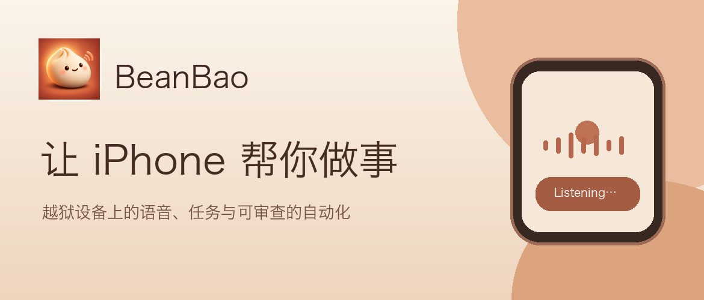
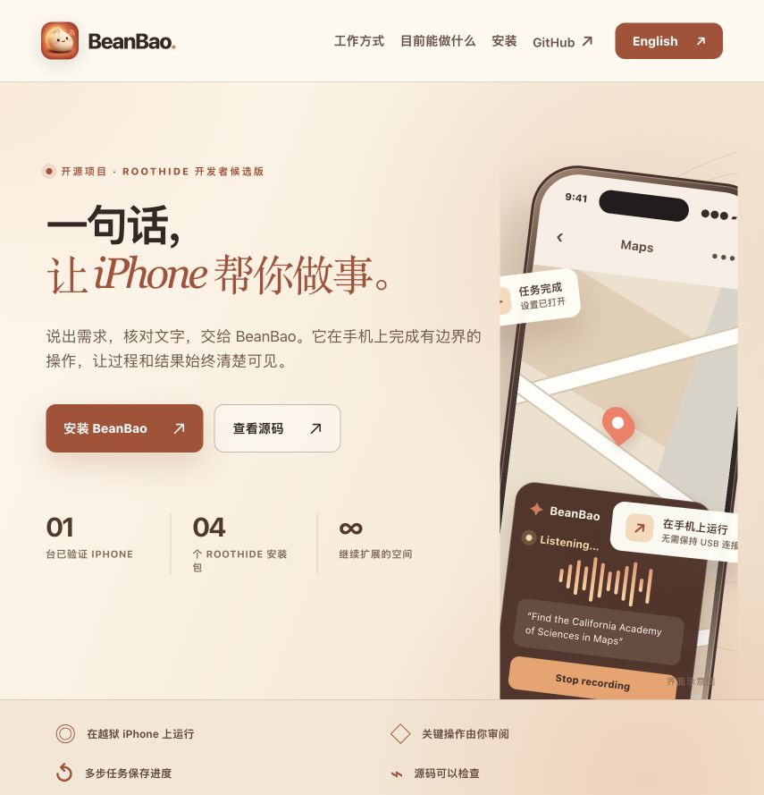
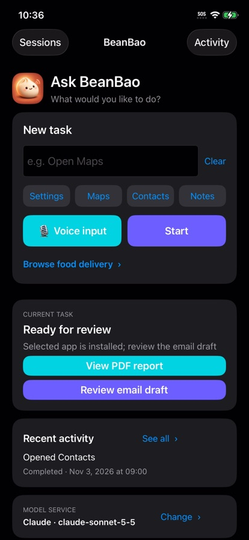
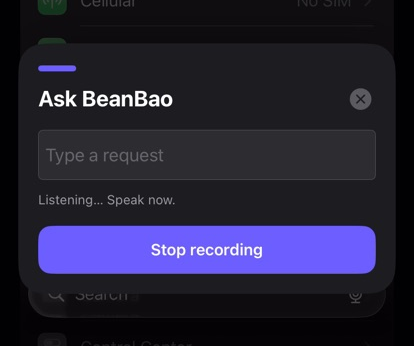
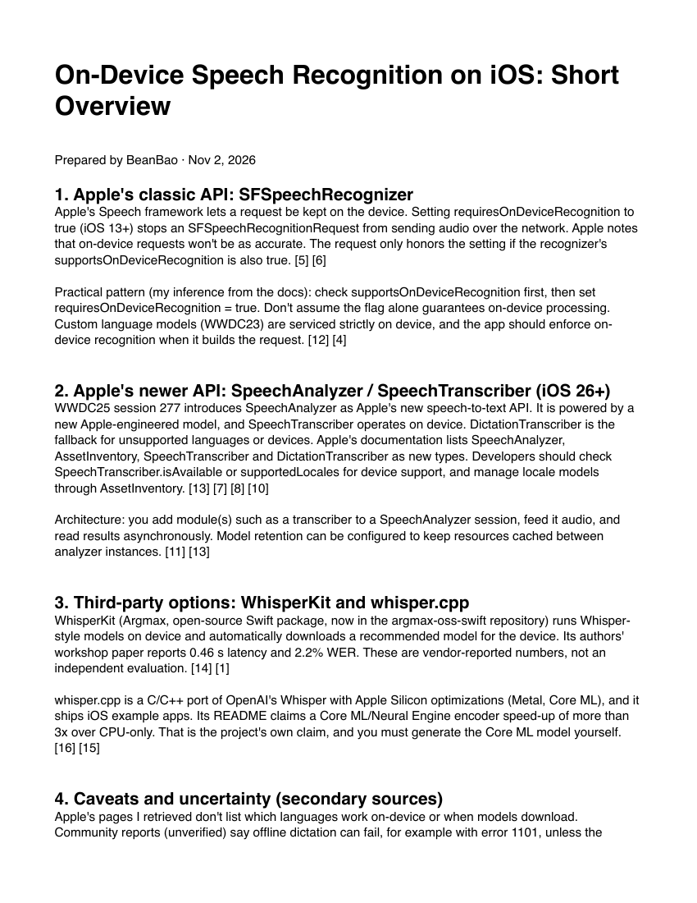
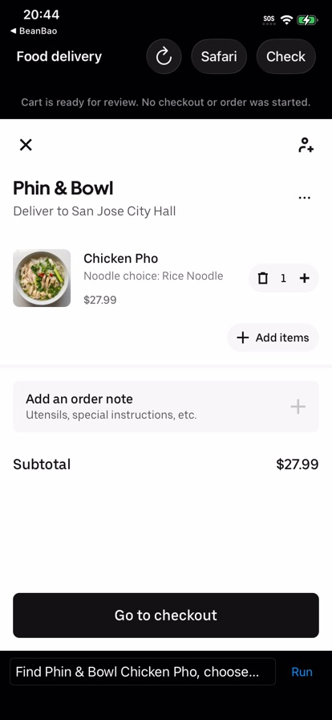
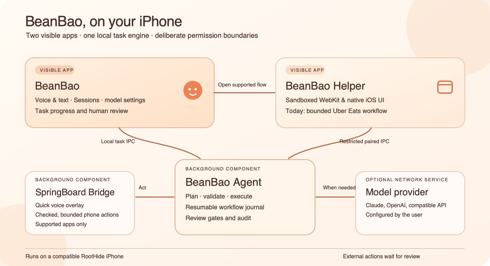

# BeanBao：让 iPhone 帮你做事

> 封面：BeanBao 项目的自制暖色插画。

BeanBao 是一个运行在越狱 iPhone 上的开源实验项目。你可以输入一句话，或通过底部语音浮层说出需求；它会把需求拆成受限步骤，在手机上执行，并让你查看结果。公开发布的 v0.3.75 采用两个桌面 App：负责发起和审阅任务的 **BeanBao**，以及承载正常 iOS 沙盒交互界面的 **BeanBao Helper**。

它已经能完成打开应用、创建备忘录、地图搜索，以及研究资料并生成 PDF 等任务。外卖购物车和 App Store 查询也有可用流程，但付款、安装和发送邮件仍需要人在关键步骤作决定。

## 先看它是什么样子

项目网站提供英文首页和简体中文页面。安装说明、设备要求和当前能力都放在页面上；英文是默认语言，中文可以手动切换。

> 图 1：BeanBao 简体中文网站的暖色首页。来源：项目网页截图。

手机里的 BeanBao 首页保留了文字输入、语音输入、最近活动和 Sessions。Sessions 是任务记录入口：完成的报告可以重新打开，等待用户审查的步骤也能从这里继续。

| BeanBao | BeanBao Helper |
| :---: | :---: |
|  |  |
| 语音、文字、会话、模型设置与结果审阅 | 正常沙盒中的网站及交互界面；目前支持有边界的 Uber Eats 流程 |

两个 App 随同一个发行包安装，不需要第二个 Apple ID 或 App Store 账号。Agent 和 SpringBoard Bridge 是后台组件，不会在主屏幕再出现两个图标。

> 图 2：测试机上的 BeanBao 首页；这里的 PDF 和邮件按钮来自一项尚待人工审查的多步任务。截图拍于 Helper 更名前，因此其中的旧外卖入口文案以 v0.3.75 的 **Open Helper · Food delivery** 为准。来源：真机截图。

## 三连按后，语音面板出现在当前界面下方

启用快捷键后，在已解锁的 iPhone 上快速三连按音量下键，会出现一个底部浮层并开始语音识别。用户可以检查转写文字，再点 Run。这个入口默认关闭；普通音量调节仍然可用。

语音转写使用 Apple 的 Speech 接口。页面上的“Listening…”表示正在听，停止录音后仍有一次核对文字的机会。它不会因为听见一句话就直接下单或发邮件。

> 图 3：在“设置”界面上显示的 BeanBao 底部语音浮层。来源：真机截图。

目前最容易上手的文字例子是“Open Settings”“Create note: BeanBao test note”和“Search Maps for Golden Gate Bridge”。这些任务的结果会再次检查，例如目标应用是否真的到了前台、备忘录标题是否出现、地图是否显示地点卡片。

## 多步任务会留下可继续的进度

一条研究指令可以要求 BeanBao 查找资料、整理来源并在手机上生成 PDF。测试机上已经跑通了研究到 PDF 的路径，也能在 Sessions 中再次打开报告。下图是一次关于 iOS 语音识别的报告第一页。

> 图 4：BeanBao 在测试机上生成的研究 PDF 首页，报告内附来源。来源：本项目真机验收产物。

如果指令同时要求准备邮件草稿或查找 App Store 应用，BeanBao 会把这几项结果留在同一个会话里。它可以准备带收件人的邮件审查入口，也可以显示候选应用及官方商店页面；真正发送邮件和安装应用由用户在系统界面完成。测试机没有配置 Apple Mail 账户，因此真实邮件发送没有验收。

流程不是无限通用的“替人点任何东西”。目前它支持的是明确设计并测试过的任务组合。遇到锁屏、页面变化或无法确认的外部操作，会停止或等待重新核验，而不是盲目重复。

## BeanBao Helper：外卖示例停在购物车和审查

需要登录网站、保存 Cookie 或使用普通 iOS 界面时，BeanBao 会打开沙盒中的 BeanBao Helper。当前发布版只为 Uber Eats 做了受限适配；这不是一个能任意操作网站的通用浏览器 Agent。一次真机测试从搜索餐品开始，选择了 Chicken Pho 所需的 Rice Noodle 选项，加入一份商品并打开购物车。截图中能看到商品、选项和小计。

> 图 5：测试购物车显示一份 Chicken Pho、Rice Noodle 选项和 27.99 美元小计；地址为公共测试地点 San Jose City Hall。没有结账或下单。来源：真机验收截图。

这个例子只证明“找商品、选选项、核对购物车”这段流程。实际结账需要登录，真实费用、付款和订单历史核对没有完成真机验收。项目对最终下单设置了单独的审查与确认机制；现阶段不应把购物车测试理解为已经能无人值守点外卖。

## 为什么是两个 App：它们需要不同的权限

**先理解 iOS 沙盒。** 正常安装的 iPhone App 会被系统放进各自的沙盒：它可以使用自己的数据容器和获准的系统服务，却不能随意读写其他 App 的容器或系统文件。这是一道由系统执行的进程边界，不是 App 自己建一个文件夹就能代替的保护。[Apple 的 iOS 安全说明](https://support.apple.com/en-au/guide/security/sec15bfe098e/web)对此有简要介绍。

**`no-sandbox` 是什么？** `com.apple.private.security.no-sandbox` 是代码签名里的私有 entitlement。RootHide 的开发文档说明，越狱环境中的二进制默认也会受到容器化约束，开发者可为确有需要的组件签入这类权限。它让 BeanBao 主 App 不受普通 App 的那套沙盒路径和进程通信限制，从而沿用本地 Agent Unix socket 等设计；源码中的 `app/entitlements.plist` 同时声明了 `platform-application`。但 `no-sandbox` **不等于以 root 身份运行**，也不等于获得所有 iOS 私有能力：文件权限、进程身份、其他系统检查和 BeanBao 自己的 Agent 策略仍分别生效。它属于越狱环境下的构建方式，不是可向普通 App Store App 申请的公开权限。[RootHide 的权限说明](https://github.com/roothide/Developer/blob/main/entitlements.md)列出了相关签名项。

**RootHide 又是什么？** 在本文的设备环境里，Relaxin 是越狱实现，RootHide 则提供 BeanBao 所依赖的越狱文件布局和打包规则。RootHide 采用 rootless 思路：越狱文件放在单独的 `jbroot` 中，而不是直接装进 iOS 系统分区。与常见固定 `/var/jb` 路径的方案不同，RootHide 使用名称可变的 `jbroot`，并提供路径转换和动态库加载方式。它旨在减少固定越狱路径的暴露；这不意味着所有 App 都不会发现越狱，也不意味着 App 自动获得 `no-sandbox`。BeanBao 的四个 `.deb` 用 `THEOS_PACKAGE_SCHEME=roothide` 构建，因此安装指南要求匹配的 RootHide 环境，不能把普通 rootless 包当作同一个发布物。参见 [RootHide 的路径说明](https://github.com/roothide/Developer/blob/main/roothide.md)和[开发者打包指南](https://github.com/roothide/Developer)。

BeanBao 最初也尝试过把所有界面放进一个 App，遇到的是一个具体的权限冲突。主 App 的签名包含上述私有权限，沿用项目现有的本地 Agent Unix socket、任务文件和 SpringBoard 语音交接方式。网站会话则需要能正常显示 `WKWebView`、保存网站状态的普通 iOS App 环境。两个桌面图标对应两种运行环境：

| | BeanBao 主 App | BeanBao Helper |
| --- | --- | --- |
| **运行权限** | RootHide 下带 `no-sandbox`、`platform-application` 签名权限的 App。 | 只有自身应用标识的签名权限，运行在普通 iOS 沙盒中。 |
| **负责的界面** | 文字与语音入口、Sessions、模型设置、PDF 和人工审阅。 | `WKWebView`、网站登录与 Cookie，以及今后可能需要普通 App 权限的交互界面。当前只适配 Uber Eats。 |
| **连接 Agent** | 使用现有的本地 Unix socket。 | 无法直接沿用主 App 的 Unix socket 和文件访问；通过本机回环地址、配对令牌与受限操作集合连接 Agent。 |
| **权限边界** | 设备任务仍须由 Agent 检查目标、状态和允许的操作。 | 不能因为同属 BeanBao 就获得主 App 的无沙盒权限，也拿不到主 App 的模型密钥或 Agent 全部操作。 |

在测试机上，**保留主 App 现有权限并嵌入 WebView** 的实验版能读取页面结构，但 WebView 画面空白；**把主 App 改为沙盒运行** 后页面可以显示，原有 Agent socket 与共享文件路径却不能直接使用。我们只确认了这两种构建的现象，尚未定位 WebKit 空白的内部原因。分成两个 App 后，主 App 继续处理设备任务，Helper 在正常沙盒里呈现网页，两条路径都能工作。

把网页留在 Helper 还有一个权限上的好处：网页内容和 WebKit 运行在普通沙盒进程里，即使网页出现问题，也不会直接获得主 App 的无沙盒进程权限。不过 Helper 仍能经受限通道请求 Agent，隔离并非绝对；Agent 必须继续逐项检查请求、页面状态与最终动作。

**两个 App 如何通信？** 它们不共享进程或数据目录，Agent 是共同的任务中枢。一次打开 Helper 并执行网页步骤的路径是：

1. 用户在 BeanBao 点 **Open Helper · Food delivery**。BeanBao 通过主 App 现有的本地 Unix socket，向 Agent 发出 `pair_delivery` 请求并取得配对令牌。
2. BeanBao 用系统的自定义 URL 打开 Helper，URL 里只带令牌。当前 URL scheme 仍是历史内部名称 `beanbaodelivery`，以便旧安装升级后继续识别；它不是两个 App 之间持续传输任务的通道。
3. Helper 的原生代码观察当前网页，通过手机自己的 `127.0.0.1:47813` 回环 TCP 端口向 Agent 发送请求，每个请求附带令牌。回环地址只在这台手机内部通信；需要联网的模型请求则由 Agent 另行处理。
4. Agent 先核对令牌和网站通道允许的操作，再规划、验证并记录步骤，把结果返回 Helper。BeanBao 之后从 Agent 读取任务状态与 Sessions；Helper 不直接读取主 App 的文件或模型密钥，也不能调用 Agent 的完整 Unix socket 接口。

令牌在 Agent 启动时随机生成，Agent 重启后失效，目前没有定时轮换。Agent 和 SpringBoard Bridge 是后台组件，**两个 App 不意味着需要两个 Apple ID 或两个 App Store 账号**。当前令牌通过自定义 URL 传递，其他 App 如果抢注同一 URL scheme 可能截获它；因此这只是开发者预览版的配对机制，不能把它当成已经与 Helper 身份强绑定的安全通道。

## 实现原理：模型提出步骤，设备负责核验

当前发布版包含两个桌面 App 和两个后台组件。**BeanBao** 负责语音、文字、会话、模型设置与结果审阅；**BeanBao Helper** 在正常 iOS 沙盒中承载 WebKit 和交互页面，目前只处理经过适配的 Uber Eats 流程。**Agent** 在手机上保存任务进度、调用用户配置的模型，并校验下一步是否在允许范围内。**SpringBoard Bridge** 提供底部语音浮层，并只为已解锁设备和受支持的应用提供受限的界面观察与操作。

> 图 6：v0.3.75 的双 App 架构。两个桌面 App 各有权限边界，通过不同范围的本地通道连接 Agent；Bridge 和 Agent 不占用桌面图标。来源：项目 README 架构图。

模型会参与理解需求、选择步骤和整理报告，但设备端会再次核对状态。一次界面动作需要新鲜的观察；发现前台应用、页面内容或目标发生变化，任务就不能直接沿用旧计划。会话会保存进度和结果，避免服务中断后从头做起；对可能已经发生的外部操作，项目倾向于停下来让人核对。

这个划分也为将来的文件选择器、分享面板或其他需要普通 App 权限的界面留出空间；这些功能尚未实现，每一种都需要单独的权限、适配和真机验证。

## 谁能安装，怎么开始

这不是普通 App Store 应用。已验证环境是一台 iPhone 11，运行 iOS 26.0.1、Relaxin 0.5.5 和 RootHide。安装者需要已有可工作的越狱环境、RootHide 包支持，以及手机 root shell 或已配对的 root SSH。其他机型、系统版本和越狱组合还需要各自测试。

发行包包含 Bridge、Agent、BeanBao Helper 和 BeanBao 四个 RootHide 包。到 [v0.3.75 发布页](https://github.com/everettjf/beanbao/releases/tag/v0.3.75) 下载未压缩的 `.tar` 与校验文件，先核对 SHA-256，再把归档传到手机的 root shell，运行包内的 `sh install.sh --dry-run` 和 `sh install.sh`。首次安装或更新 Bridge 后，需要重载 SpringBoard 并手动解锁；只升级两个 App 不需要重载。随后在 BeanBao 中填入自己的模型 API Key 和模型名，从文字任务开始测试；不应把密钥放进聊天、截图或发布包。

安装步骤和支持范围以项目 README 与发布页为准。当前项目还没有普通用户的一键安装源，首次在另一台手机上安装也尚未验证。

## 现在的边界

在这台测试机上，文字任务、语音浮层、部分模型辅助任务、研究 PDF 和购物车审查已经有实际运行记录。v0.3.75 的两个 App 已在这台手机上升级安装并核对版本，但此前通过的所有任务没有在更名后的构建上逐项重跑。Apple Mail 账户下的真实邮件撰写与发送、新应用安装后的验收、外卖最终付款与订单确认，还缺真机证据。

BeanBao 的方向是把手机上的操作变成可以查看、暂停和核对的任务。对于已实现的能力，README 和验收记录会持续给出可复现的例子；对于尚未验证的环节，先保留清晰的人工接管点。

## 参考来源

以下项目链接于 2026-11-03 核对。具体功能与限制另依据同目录 `sources.md` 所列代码、文档和真机截图。

BeanBao 源码仓库 : https://github.com/everettjf/beanbao

BeanBao v0.3.75 安装发布页 : https://github.com/everettjf/beanbao/releases/tag/v0.3.75

BeanBao 双 App 架构说明 : https://github.com/everettjf/beanbao/blob/v0.3.75/docs/two-app-architecture.md

BeanBao 项目网站 : https://xnu.app/beanbao/
